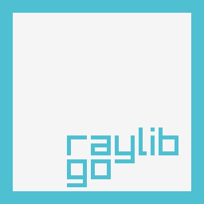

## raylib-go
[](https://github.com/gen2brain/raylib-go/actions)
[](https://pkg.go.dev/github.com/gen2brain/raylib-go/raylib)
[](https://github.com/gen2brain/raylib-go/tree/master/examples)

Golang bindings for [raylib](https://www.raylib.com/), a simple and easy-to-use library to enjoy videogames programming.

raylib C source code is included and compiled together with bindings. Note that the first build can take a few minutes.

It is also possible to use raylib-go without cgo (see requirements below).

### Requirements

#### cgo

##### Ubuntu

    apt-get install libgl1-mesa-dev libxi-dev libxcursor-dev libxrandr-dev libxinerama-dev libwayland-dev libxkbcommon-dev

##### Fedora

    dnf install mesa-libGL-devel libXi-devel libXcursor-devel libXrandr-devel libXinerama-devel wayland-devel libxkbcommon-devel

##### macOS

On macOS, you need Xcode or Command Line Tools for Xcode (if you have `brew` installed, you already have this).

##### Windows

On Windows you need C compiler, like [Mingw-w64](https://mingw-w64.org) or [TDM-GCC](http://tdm-gcc.tdragon.net/).
You can also build binary in [MSYS2](https://msys2.github.io/) shell.

To remove console window, build with `-ldflags "-H=windowsgui"`.

##### Android

[Android example](https://github.com/gen2brain/raylib-go/tree/master/examples/others/android/example).

##### Wasm

For web bindings, refer to [Raylib-Go-Wasm](https://github.com/BrownNPC/Raylib-Go-Wasm); it should be largely compatible with this repository.

#### purego (without cgo)

You can use raylib-go on `Linux`, `macOS`, `Windows` and `FreeBSD` without the need of [cgo](https://go.dev/blog/cgo), i.e. with `CGO_ENABLED=0`,
or with the `nocgo` build tag when cgo is enabled, for example when raylib's C symbols clash with another cgo library. 32-bit is not supported.

The shared libraries (.so, .dylib, .dll) of raylib are embedded for Linux, macOS and Windows on amd64 and arm64, built from the same bundled C sources.
They are unpacked to a temporary directory at startup and removed again. With the build tag `extlib` nothing is embedded and the system raylib library is loaded instead.

On FreeBSD build with `-gcflags="github.com/ebitengine/purego/internal/fakecgo=-std"`.


### Installation

    go get -v -u github.com/gen2brain/raylib-go/raylib

### Build tags

Platforms (cgo, default is [GLFW](https://www.glfw.org/)):

| Tag      | Description                                                                                                                                |
|----------|--------------------------------------------------------------------------------------------------------------------------------------------|
| `drm`    | Linux native [DRM](https://en.wikipedia.org/wiki/Direct_Rendering_Manager) mode, including Raspberry Pi 4 and other devices (PLATFORM_DRM) |
| `sdl`    | [SDL](https://github.com/libsdl-org/SDL) backend (PLATFORM_DESKTOP_SDL)                                                                    |
| `sdl3`   | [SDL3](https://github.com/libsdl-org/SDL) backend (PLATFORM_DESKTOP_SDL3)                                                                  |
| `rgfw`   | [RGFW](https://github.com/ColleagueRiley/RGFW) backend (PLATFORM_DESKTOP_RGFW)                                                             |
| `win32`  | Native Win32 backend, Windows only (PLATFORM_DESKTOP_WIN32)                                                                                |
| `memory` | Headless, renders to memory with the software renderer, no window or GPU (PLATFORM_MEMORY)                                                 |

Graphics API (cgo, default is OpenGL 3.3 on desktop):

| Tag        | Description                                                                                   |
|------------|-----------------------------------------------------------------------------------------------|
| `opengl43` | OpenGL 4.3                                                                                    |
| `opengl21` | OpenGL 2.1                                                                                    |
| `opengl11` | OpenGL 1.1 (pseudo OpenGL 1.1 style)                                                          |
| `es2`      | OpenGL ES 2.0 (can be used to link against [Google's ANGLE](https://github.com/google/angle)) |
| `es3`      | OpenGL ES 3.0 (experimental)                                                                  |
| `software` | Software renderer, no GPU needed (with `sdl`, `sdl3`, `rgfw`, `drm` or `win32`)               |

Options:

| Tag       | Description                                                                   |
|-----------|-------------------------------------------------------------------------------|
| `x11`     | Force X11 compatibility mode on Wayland (GLFW)                                |
| `wayland` | Force Wayland only mode (GLFW)                                                |
| `noaudio` | Disable audio functions                                                       |
| `nocgo`   | Use the purego backend even when cgo is enabled                               |
| `extlib`  | Load the system raylib library instead of the embedded one (used with purego) |

### Documentation

Documentation on [pkg.go.dev](https://pkg.go.dev/github.com/gen2brain/raylib-go/raylib). Also check raylib [cheatsheet](https://www.raylib.com/cheatsheet/cheatsheet.html). If you have problems or need assistance there is an active community in the #raylib-go channel of the [Raylib Discord Server](https://discord.gg/raylib) that can help.

### Example

```go
package main

import rl "github.com/gen2brain/raylib-go/raylib"

func main() {
  rl.InitWindow(800, 450, "raylib [core] example - basic window")
  defer rl.CloseWindow()

  rl.SetTargetFPS(60)

  for !rl.WindowShouldClose() {
    rl.BeginDrawing()

    rl.ClearBackground(rl.RayWhite)
    rl.DrawText("Congrats! You created your first window!", 190, 200, 20, rl.LightGray)

    rl.EndDrawing()
  }
}
```

Check more [examples](https://github.com/gen2brain/raylib-go/tree/master/examples) organized by raylib modules.

### Cross-compile (on Linux with cgo)

To cross-compile for Windows install [MinGW](https://www.mingw-w64.org/) toolchain.

```
$ CGO_ENABLED=1 CC=x86_64-w64-mingw32-gcc GOOS=windows GOARCH=amd64 go build -ldflags "-s -w"
$ file basic_window.exe
basic_window.exe: PE32+ executable (console) x86-64 (stripped to external PDB), for MS Windows, 11 sections

$ CGO_ENABLED=1 CC=i686-w64-mingw32-gcc GOOS=windows GOARCH=386 go build -ldflags "-s -w"
$ file basic_window.exe
basic_window.exe: PE32 executable (console) Intel 80386 (stripped to external PDB), for MS Windows, 9 sections
```

To cross-compile for macOS install [OSXCross](https://github.com/tpoechtrager/osxcross) toolchain.

```
$ CGO_ENABLED=1 CC=x86_64-apple-darwin21.1-clang GOOS=darwin GOARCH=amd64 go build -ldflags "-linkmode external -s -w '-extldflags=-mmacosx-version-min=10.15'"
$ file basic_window
basic_window: Mach-O 64-bit x86_64 executable, flags:<NOUNDEFS|DYLDLINK|TWOLEVEL>

$ CGO_ENABLED=1 CC=aarch64-apple-darwin21.1-clang GOOS=darwin GOARCH=arm64 go build -ldflags "-linkmode external -s -w '-extldflags=-mmacosx-version-min=12.0.0'"
$ file basic_window
basic_window: Mach-O 64-bit arm64 executable, flags:<NOUNDEFS|DYLDLINK|TWOLEVEL|PIE>
```

### License

raylib-go is licensed under an unmodified zlib/libpng license. View [LICENSE](https://github.com/gen2brain/raylib-go/blob/master/LICENSE).
